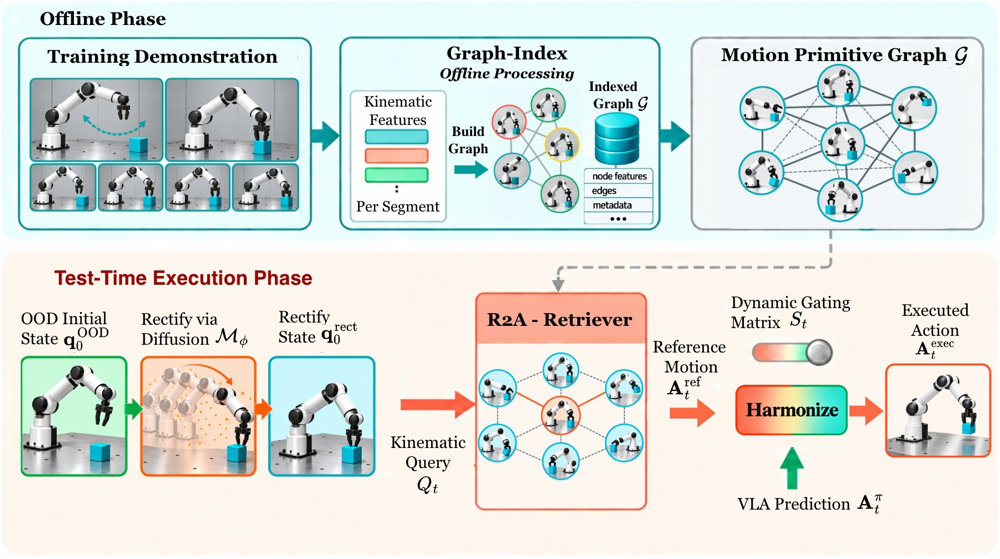

# Retrieve to Act: Motion Primitive Graph Retrieval for Robust VLA Execution

## Project page: [retrieve2act.github.io/r2a](https://retrieve2act.github.io/r2a/)

Anonymous submission, under double-blind review.

## Overview



VLA policies generalize across instructions, but a moved camera, a new texture or different
lighting at execution time pushes their actions off safe trajectories. The motion in their training
demonstrations still applies under these shifts.

Retrieve to Act (R2A) cuts the demonstrations of a task suite into motion primitives and stores them
as a graph. While the policy runs, a query built from the robot's state and the policy's own action
chunk retrieves the demonstrated continuation that fits, and a learned per-dimension gate blends it
into the chunk the robot executes. Before the first step, an entry corrector moves an
out-of-distribution start pose back onto a demonstrated one. The policy's weights are never
changed, and every component is fit offline on the demonstrations.

This repository has the offline build, the training and the evaluation harnesses for StableVLA,
GR00T N1.7 and pi0.5 on LIBERO, LIBERO-Plus, RoboTwin 2.0 and RoboTwin 2.0-Plus, plus a deployment
for a real ALOHA arm.

## Table of contents

- [1. Install](#1-install)
- [2. Download policy checkpoints](#2-download-policy-checkpoints)
- [3. Download R2A artifacts](#3-download-r2a-artifacts)
- [4. Evaluate](#4-evaluate)
- [5. Train from scratch (optional)](#5-train-from-scratch-optional)
- [6. Real robot](#6-real-robot)

## 1. Install

Run every command from the repository root, after `source ./env.sh`.

```bash
# StableVLA trunk (sparse copy of DAGroup-PKU/HumanNet)
git clone --filter=blob:none --no-checkout https://github.com/DAGroup-PKU/HumanNet.git /tmp/hn
git -C /tmp/hn sparse-checkout init --cone
git -C /tmp/hn sparse-checkout set src/model/StableVLA
git -C /tmp/hn checkout 68eb86d555fc4d3b09003319cff7644cd4c8b571
mkdir -p stablevla external && cp -a /tmp/hn/src/model/StableVLA/. stablevla/ && rm -rf /tmp/hn

./install_stablevla.sh
source ./env.sh

# benchmarks
python -m robot_ood.cli bench setup libero_plus
python -m robot_ood.cli bench setup libero
python -m robot_ood.cli bench setup robotwin
bash evals/robotwin_plus/setup.sh
```

If the container has no NVIDIA GL driver, run `scripts/setup_nvidia_gl.sh` once.

## 2. Download policy checkpoints

```bash
# StableVLA
hf download Qwen/Qwen2.5-0.5B
for s in long object spatial goal; do
  hf download DAGroup-PKU/StableVLA --local-dir stablevla/hf_weights \
      --include "pretrained_models/*" --include "$s/*"
done

# GR00T N1.7 (first accept the license of nvidia/Cosmos-Reason2-2B and run `hf auth login`)
git clone --branch n1.7-release --depth 1 https://github.com/NVIDIA/Isaac-GR00T external/Isaac-GR00T
(cd external/Isaac-GR00T && uv sync && uv pip install websockets h5py)
external/Isaac-GR00T/.venv/bin/hf download nvidia/GR00T-N1.7-LIBERO --local-dir gr00t/hf_weights \
    --exclude "*/global_step*/*" "*/rng_state*" "*.pth" "*optim*" "*/latest" "*/zero_to_fp32.py" "*/scheduler.pt"

# pi0.5, LIBERO and RoboTwin
bash evals/pi05/setup.sh
```

To check that a policy loads:

```bash
python -m robot_ood.cli eval --bench libero_plus --suite long --mode base --policy stablevla --check-env
```

## 3. Download R2A artifacts

Each policy and suite has its own trained tree. `artifacts fetch` downloads one into
`outputs/<tree>/artifacts`:

```bash
python -m robot_ood.cli artifacts fetch long --suite long
```

| policy | trees |
|---|---|
| StableVLA | `long` `object` `spatial` `goal` |
| GR00T N1.7 | `long_gr00t` `object_gr00t` `spatial_gr00t` `goal_gr00t` |
| pi0.5, LIBERO | `long_pi05` `object_pi05` `spatial_pi05` `goal_pi05` |
| pi0.5, RoboTwin | `g1_left` `g1_right` ... `g5_left` `g5_right` |

## 4. Evaluate

`--mode base` runs the frozen policy and `--mode fcsr` runs it with R2A. A cell prints a `RESULT`
line and writes `summary.json` under `results/`.

LIBERO-Plus, GR00T N1.7 on `long` under camera shift:

```bash
python -m robot_ood.cli eval --bench libero_plus --rung R4 --suite long --axis Camera_Viewpoints \
    --mode fcsr --policy gr00t --artifacts outputs/long_gr00t/artifacts --trials 1 --gpus 0,1,2,3
```

LIBERO, 50 trials per task:

```bash
python -m robot_ood.cli eval --bench libero --suite long \
    --mode fcsr --policy gr00t --artifacts outputs/long_gr00t/artifacts --trials 50 --gpus 0,1,2,3
```

RoboTwin 2.0-Plus, pi0.5 on group `g1`. The environment variables are the rollout settings of the
paper's `fcsr` runs; leave them out for `base`:

```bash
ROBOT_OOD_EXEC_HORIZON=50 ROBOT_OOD_PAIR=1 ROBOT_OOD_STALL_PUSH=3 ROBOT_OOD_STALL_DWELL=1 \
ROBOT_OOD_GRASP_SERVO=80 python -m robot_ood.cli eval --bench robotwin_plus --suite g1 --axis Camera \
    --mode fcsr --policy pi05_robotwin --trials 10 --gpus 0,1,2,3
```

| argument | values |
|---|---|
| `--bench` | `libero_plus`, `libero`, `robotwin_plus` |
| `--suite` | LIBERO: `long` `object` `spatial` `goal`. RoboTwin: `g1` to `g5` |
| `--axis` | LIBERO-Plus: `Robot_Initial_States` `Objects_Layout` `Camera_Viewpoints` `Sensor_Noise` `Background_Textures` `Light_Conditions` `Language_Instructions`. RoboTwin-Plus: `Original` `Camera` `Robot` `Language` `Light` `Background` `Noise` `Layout` |
| `--policy` | `stablevla`, `gr00t`, `pi05`, `pi05_robotwin` |
| `--artifacts` | the tree from step 3 for this policy and suite. RoboTwin finds `g<n>_left` and `g<n>_right` itself |
| `--rung R4` | the full LIBERO-Plus episode set; without it a cell runs a short smoke subset |
| `--resume` | continue a cell that stopped partway |

Score finished cells into one table:

```bash
python evals/libero_plus/score.py --suites long object spatial goal --methods base:gr00t_base fcsr:gr00t_fcsr
python evals/libero_plus/score.py --bench robotwin_plus --suites g1 g2 g3 g4 g5 \
    --methods base:pi05_robotwin_base fcsr:pi05_robotwin_fcsr
```

## 5. Train from scratch (optional)

Rebuilds `outputs/<tree>/artifacts` from the demonstrations. Not needed after step 3.

**LIBERO demonstrations**

```bash
python -c "
from robot_ood.core.paths import default_paths
from libero.libero.utils.download_utils import download_from_huggingface
for n in ('libero_10', 'libero_goal', 'libero_object', 'libero_spatial'):
    download_from_huggingface(n, str(default_paths().data / 'libero_datasets'), check_overwrite=False)"
```

**RoboTwin demonstrations**

```bash
python - <<'PY'
import zipfile
from pathlib import Path
from huggingface_hub import hf_hub_download
raw = Path("data/robotwin/raw")
for task in (l.strip() for l in Path("evals/robotwin/suites/all.txt").read_text().splitlines()):
    if not task or task.startswith("#") or (raw / task).exists():
        continue
    z = hf_hub_download("TianxingChen/RoboTwin2.0", f"dataset/{task}/aloha-agilex_clean_50.zip",
                        repo_type="dataset", local_dir="data/robotwin/zips")
    zipfile.ZipFile(z).extractall(raw / task)
PY
for t in g{1..5}_{left,right}; do python -m robot_ood.data.robotwin --suite $t; done
```

**Build and train one tree.** StableVLA trees skip `cache-policy`.

```bash
python -m robot_ood.cli cache-policy --suite long_gr00t --port 14200 --gpu 0
python -m robot_ood.cli build --suite long_gr00t --device cuda:0
python -m robot_ood.cli train --suite long_gr00t --device cuda:0
python -m robot_ood.cli artifacts check outputs/long_gr00t/artifacts --stage deploy
```

## 6. Real robot

`deploy/aloha_right/` serves GR00T N1.7 with R2A for the right arm of an ALOHA through GR00T's own
policy server. [`docs/train_aloha.md`](docs/train_aloha.md) builds its tree from two LeRobot datasets.

`deploy/vrh31_waist/` turns the waist of a VR-H3.1 until the head camera matches the demo view, then
serves GR00T N1.7. `deploy/vrh31_bds_pick/` runs a VR-H3.1 bimanual pick with GR00T N1.7 behind R2A,
one lane per arm.

## Documentation

| document | contents |
|---|---|
| [`docs/SETUP.md`](docs/SETUP.md) | installing on a bare machine |
| [`docs/method-offline.md`](docs/method-offline.md), [`docs/method-runtime.md`](docs/method-runtime.md) | how the graph is built and how R2A acts at run time |
| [`docs/artifacts.md`](docs/artifacts.md) | the files in an artifact tree |
| [`docs/configuration.md`](docs/configuration.md) | where each setting is defined and which one wins |
| [`evals/gr00t`](evals/gr00t/README.md), [`evals/pi05`](evals/pi05/README.md), [`evals/stablevla`](evals/stablevla/README.md) | per-policy servers and checkpoints |
| [`evals/libero_plus`](evals/libero_plus/README.md), [`evals/robotwin_plus`](evals/robotwin_plus/README.md) | per-benchmark protocols |

Tests: `python -m pytest tests/ -q`.

## Citation

```bibtex
@inproceedings{r2a2027,
  title     = {Retrieve to Act: Motion Primitive Graph Retrieval for Robust {VLA} Execution},
  author    = {Anonymous},
  booktitle = {Under review},
  year      = {2026}
}
```

## Acknowledgement

This code builds on [LIBERO](https://github.com/Lifelong-Robot-Learning/LIBERO),
[LIBERO-Plus](https://github.com/sylvestf/LIBERO-plus),
[RoboTwin 2.0](https://github.com/RoboTwin-Platform/RoboTwin),
[RoboTwin2.0-Plus](https://github.com/Robot-Robustness/RoboTwin2.0-Plus),
[StableVLA](https://github.com/DAGroup-PKU/HumanNet),
[Isaac-GR00T](https://github.com/NVIDIA/Isaac-GR00T) and
[openpi](https://github.com/Physical-Intelligence/openpi). Pinned commits and licenses are in
[`UPSTREAM.md`](UPSTREAM.md).
